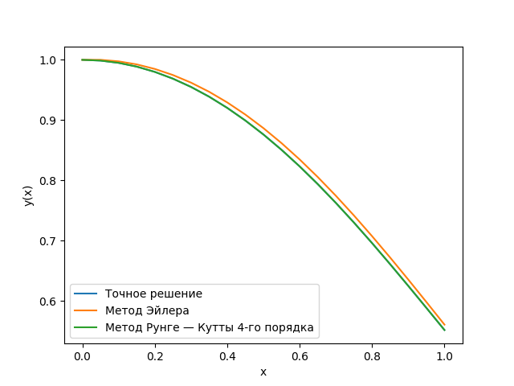

# Лабораторная работа № 2

## Численное решение задачи Коши

В работе сравниваются метод Эйлера и классический метод Рунге — Кутты четвёртого порядка. Оба метода приближённо решают одну и ту же задачу на одинаковой сетке; аналитическое решение нужно для проверки точности.

## Постановка задачи

Требуется решить задачу Коши

$$
\begin{cases}
y'(x) + 2xy(x) = xe^{-x^2}, \\
y(0) = 1,
\end{cases}
\qquad x \in [0,1], \qquad h = 0.05.
$$

Для численного расчёта уравнение записывается в виде

$$
y' = f(x,y), \qquad f(x,y) = xe^{-x^2} - 2xy.
$$

Шаг сетки равен $h=0.05$, поэтому отрезок $[0,1]$ содержит 20 шагов и 21 узел:

$$
x_i = x_0 + ih, \qquad i=0,1,\ldots,20.
$$

## Точное решение

Уравнение линейное. Его интегрирующий множитель равен

$$
\mu(x) = e^{\int 2x\,dx} = e^{x^2}.
$$

После умножения уравнения на этот множитель получаем

$$
\left(y e^{x^2}\right)' = x.
$$

Интегрирование даёт $y e^{x^2}=\frac{x^2}{2}+C$. Из начального условия $y(0)=1$ следует $C=1$, поэтому точное решение:

$$
y(x) = \left(1+\frac{x^2}{2}\right)e^{-x^2}.
$$

В правом конце отрезка:

$$
y(1) = \frac{3}{2e} \approx 0.551819161757.
$$

Эта формула используется для сравнения с численными методами. Методы Эйлера и Рунге — Кутты её при вычислении своих значений не используют.

## Метод Эйлера

Если $y_i$ — приближённое значение решения в узле $x_i$, следующий узел рассчитывается по формуле

$$
y_{i+1} = y_i + h f(x_i,y_i), \qquad i=0,1,\ldots,19,
$$

где $y_0=1$. На каждом шаге берётся наклон в начале шага и по нему оценивается изменение решения на всём шаге.

## Метод Рунге — Кутты четвёртого порядка

Метод оценивает наклон четыре раза: в начале шага, дважды в середине и в конце. В программе коэффициенты уже включают шаг $h$:

$$
\begin{aligned}
K_1 &= h f(x_i,y_i), \\
K_2 &= h f\left(x_i+\frac{h}{2},\ y_i+\frac{K_1}{2}\right), \\
K_3 &= h f\left(x_i+\frac{h}{2},\ y_i+\frac{K_2}{2}\right), \\
K_4 &= h f(x_i+h,\ y_i+K_3), \\
y_{i+1} &= y_i + \frac{K_1+2K_2+2K_3+K_4}{6}.
\end{aligned}
$$

Две оценки в середине получают вес 2, а оценки в начале и конце — вес 1. Это помогает точнее оценить изменение решения за шаг, чем если учитывать только наклон в его начале.

## Реализация

Основной скрипт — [main.py](main.py).

- `f(x, y)` вычисляет правую часть дифференциального уравнения.
- `exact(x)` вычисляет точное решение для сравнения.
- `euler(x_values)` строит приближённые значения методом Эйлера.
- `runge_kutta(x_values)` строит приближённые значения методом Рунге — Кутты 4-го порядка.
- `main()` создаёт сетку, запускает расчёты, записывает таблицу, строит график и считает ошибки при $x=1$.

Абсолютная погрешность в конце отрезка вычисляется по формуле

$$
\varepsilon = \left|y_{\text{числ}}(1)-y_{\text{точн}}(1)\right|.
$$

## Результаты

| Решение при $x=1$ | Значение | Абсолютная погрешность |
| --- | ---: | ---: |
| Точное | 0.551819161757 | — |
| Метод Эйлера | 0.560752036129 | 0.008932874372 |
| Метод Рунге — Кутты 4-го порядка | 0.551819160911 | 8.46557·10⁻¹⁰ |

При одинаковом шаге результат метода Рунге — Кутты в этой задаче ближе к точному значению.

## Файлы результатов

- [results.csv](results/results.csv) — значения $x$, точного решения и решений обоими численными методами во всех узлах сетки. В CSV каждое число записано с шестью знаками после запятой.
- [solution_plot.png](results/solution_plot.png) — график точного решения и приближений Эйлера и Рунге — Кутты.

Задание требует таблицу значений решения и графики, но не задаёт формат CSV. В этой реализации CSV используется как удобный формат для сохранения таблицы.



## Запуск

Из корня репозитория:

```bash
uv run python laba_2/main.py
```

Запуск пересчитывает таблицу и график в папке `laba_2/results`.
